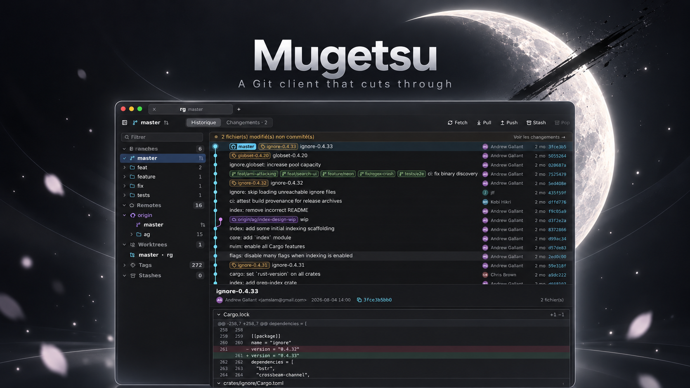

<p align="center"></p>

<h1 align="center">月 Mugetsu</h1>

<p align="center">
  <b>A fast, GPU-rendered Git client for macOS and Windows, written in Rust.</b><br>
  Dense and keyboard-driven, with a colourful graph and a dark frosted-glass look.
</p>

<p align="center">
  <a href="https://github.com/ziracmo/mugetsu/releases/latest/download/Mugetsu.dmg"><b>Download for macOS</b></a>
  ·
  <a href="https://github.com/ziracmo/mugetsu/releases/latest/download/Mugetsu-Setup.exe"><b>Download for Windows</b></a>
  ·
  <a href="https://ziracmo.github.io/mugetsu/">Website</a>
  ·
  <a href="https://ziracmo.github.io/mugetsu/releases.html">Release notes</a>
</p>

---

## Why Mugetsu

- **Fast on huge repositories.** The commit graph is drawn on the GPU and only visible rows are rendered.
  git.git's 85k commits load in under a second.
- **Many repositories at once.** Tabs, workspaces, a ⌃Tab switcher, and background fetches that tell you
  when a remote moved.
- **GitHub built in.** Pull requests, CI status and reviews right on your branches.
- **Keyboard first.** Every common action has a shortcut.

## Download

| Platform | File |
| --- | --- |
| macOS 12+ (Apple silicon and Intel) | [Mugetsu.dmg](https://github.com/ziracmo/mugetsu/releases/latest/download/Mugetsu.dmg) |
| Windows 10/11 x64 | [Mugetsu-Setup.exe](https://github.com/ziracmo/mugetsu/releases/latest/download/Mugetsu-Setup.exe) |

All versions are on the [Releases page](https://github.com/ziracmo/mugetsu/releases).

> **First launch.** Builds are not signed yet.
> **macOS:** drag Mugetsu to Applications, then **right-click › Open** the first time.
> On macOS 15+, use **System Settings › Privacy & Security › Open Anyway**, or run
> `xattr -dr com.apple.quarantine /Applications/Mugetsu.app`.
> **Windows:** if SmartScreen warns, click **More info › Run anyway**.

## Features

### History

- **GPU commit graph**, virtualized: smooth with 100k+ commits.
- **Commit search** (⌘F) by message, author, branch, tag or SHA, with matches highlighted.
- **Commit details**: changed files as a tree, folded description, one-click SHA copy.
- **Diff view** with syntax highlighting and intra-line changes.
- **Author avatars** from GitHub or Gravatar, cached on disk.
- **Compact view** (⇧⌘K): one row per branch with the commits it adds over the trunk; hover to list them.
- Press **F** to jump back to the current branch.

### Branches and sidebar

- Branches grouped into folders (`feat/…`, `fix/…`), with ahead/behind counts and a GitHub icon when pushed.
- Remotes, tags, stashes and worktrees, with a filter field and sections you can reorder by dragging.
- **Double-click to checkout**: keep, stash or discard local changes, name the local branch.
  The new HEAD shows instantly.
- **Right-click menus** everywhere: checkout (or as worktree), fast-forward, push, rename, delete,
  reset, cherry-pick, revert, save as patch, create or open a pull request…

### Changes

- Stage and unstage by file or by hunk.
- Commit, amend, commit and push.
- **Push sheet**: target branch, tags, force with lease. Pull (fast-forward), stash and pop.

### Multi-repository

- **Tabs** with an indicator for uncommitted changes and an optional emoji per repository; reopened at launch.
- **Workspaces**: named sets of repositories, switched from the title bar.
- **Tab switcher**: hold ⌃ and press Tab to pick a repository from cards.
- **Auto-fetch** every 10 s for the focused repository, every 5 min for the others; a pulsing dot shows when
  a remote moved.
- **Open repository** (⌘O) from recents or your project folders.
- **New window** (⇧⌘N) for another set of repositories.

### GitHub pull requests

- A `#123` chip on each branch with a PR, coloured by state, with CI result and unresolved conversations.
  Hover for a card that appears at once: author avatar, failing checks, review decision.
- **PRs tab**: open PRs (reviews you owe first), drafts, stacks with their `n/total` position, and recently
  merged PRs. Filters: all / mine / to review.
- **PR view**: click a PR to see it in the main pane: CI, review and conversations, description, commits and
  diff against its base. Double-click jumps to its branch.
- **Stack view**: click a stack to see its progress, which PRs are ready, and the next step to unblock it.
- **AI review**: right-click a PR to run Claude Code (`/code-review`), Codex or your own command on it, in a
  Terminal inside the repository (Settings › AI).

### Stats

A **Stats view** (⌘3) built from commits only, so no API rate limit: top authors and lines changed,
reviewers, mergers, co-authors, activity chart, weekday × hour heatmap and hot files, from 7 days to all
history.

### Look and feel

- Dark frosted-glass theme with a configurable accent colour.
- English or French; settings in sections, including your git name and email.
- **About Mugetsu** in the app menu, with the version and build.
- Small touches: new commits shimmer in, pushed branches glow, a deleted branch gets slashed, a sweep after
  checkout, a liquid wave on Fetch / Pull / Push while they run.

## Keyboard shortcuts

On Windows, use Ctrl instead of ⌘.

| Action | Keys |
| --- | --- |
| Changes / History / Stats | ⌘1 / ⌘2 / ⌘3 |
| Commit / Commit and push | ⌘↩ / ⇧⌘↩ |
| Fetch / Pull / Push | ⇧⌘F / ⇧⌘L / ⇧⌘P |
| New branch / New tag | ⇧⌘B / ⇧⌘G |
| Checkout branch | ⌘B |
| Stash | ⇧⌘H |
| Search commits | ⌘F |
| Reveal HEAD | ⌘0 (or F) |
| Compact history | ⇧⌘K |
| Previous / next commit | ↑ ↓ (or k j) |
| Open repository / New tab / Close tab | ⌘O / ⌘T / ⌘W |
| New window | ⇧⌘N |
| Switch tab | ⌃Tab / ⌃⇧Tab |
| Toggle sidebar | ⌃⌘S |
| Refresh | ⌘R |
| Settings | ⌘, |

In Changes, ⌘A stages everything and ⌘S stashes.

## Build from source

Requirements: recent stable Rust and `git` (on macOS, the Xcode Command Line Tools).
For pull requests, run `gh auth login` or set `GITHUB_TOKEN`.

```sh
# Run, optionally opening repositories
cargo run --release -p mugetsu-app -- ~/code/my-repo

# macOS: build Mugetsu.app and install it in /Applications (--no-install to only build it)
scripts/bundle-macos.sh

# Tests
cargo test --workspace
```

## More

- [Architecture, performance and tests](docs/ARCHITECTURE.md)
- [Releasing and code signing](docs/RELEASING.md)
