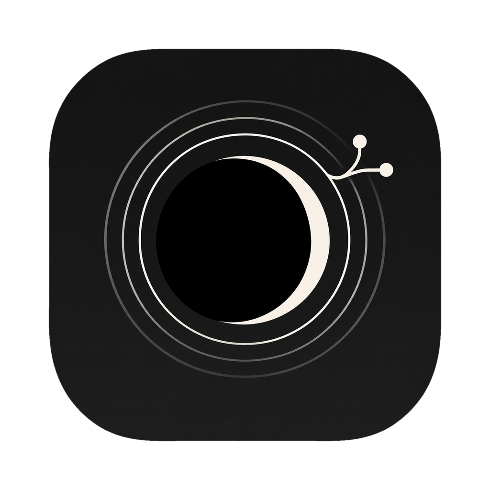

<p align="center"></p>

# 月 Mugetsu

A fast desktop Git client for macOS, written in Rust. Inspired by Fork (density, efficiency) and GitKraken (colourful graph), with a dark, frosted-glass look.

## Features

- **Multi-repository tabs**: only the active tab is rendered; the others keep their data in memory at no drawing cost. Open repositories are restored at launch.
- **Commit graph** rendered on the GPU (GPUI) in a virtualized list: only visible rows are drawn, even with 100k+ commits.
- **Sidebar**: branches grouped into folders like Fork (`feat/…`, `fix/…`), main/develop/master/staging highlighted, GitHub icon on pushed branches, ahead/behind counts, remotes, worktrees (click to open in a tab), tags, stashes, and a filter field. Collapsible with ⌃⌘S.
- **Ref chips**: a local branch identical to its remote counterpart shows as a single chip with a dark remote icon.
- **Right-click menus** on branches, remote branches, tags and commits: checkout, checkout as worktree, fast-forward, push, create/open pull request, rename, delete, new branch/tag here, reset (soft/mixed/hard), cherry-pick, revert, save as patch, copy name/SHA.
- **Commit search** (⌘F / Ctrl+F) by message, author or SHA, with next/previous match.
- **Author avatars** from GitHub (noreply addresses) or Gravatar, cached on disk, with initials as a fallback.
- **Diff** view with syntax highlighting and intra-line changes.
- **Changes**: stage/unstage per file or per hunk, commit, amend, commit and push.
- **Automatic fetch** every 10 s for the focused repository and every 5 min for the others. A pulsing dot appears on a tab when one of its remotes moved.
- **GitHub pull requests**: each branch with a PR shows a `#123` chip coloured by state; clicking it opens the PR.
- Pull (fast-forward only), push (sets the upstream when needed), stash and pop, double-click a branch to check it out (with a small particle burst).

## Keyboard shortcuts

Same as Fork on macOS where they exist.

| Action | Keys |
| --- | --- |
| Commit / Commit and push | ⌘↩ / ⇧⌘↩ |
| Fetch | ⇧⌘F |
| Pull | ⇧⌘L |
| Push | ⇧⌘P |
| New branch / New tag | ⇧⌘B / ⇧⌘G |
| Stash | ⇧⌘H |
| Show changes / All commits | ⌘1 / ⌘2 |
| Reveal HEAD | ⌘0 |
| Search commits | ⌘F (or ⌃F) |
| Checkout branch | ⌘B |
| Refresh | ⌘R |
| Open repository / New tab | ⌘O / ⌘T |
| Close tab | ⌘W |
| Next / previous tab | ⌃Tab / ⌃⇧Tab |
| Toggle sidebar | ⌃⌘S |
| Previous / next commit | ↑ ↓ (or k j) |

## Install as a macOS app

```sh
scripts/bundle-macos.sh
```

This builds `Mugetsu.app` with its icon, signs it ad hoc and copies it to `/Applications`, so it shows up in Launchpad, Spotlight and the Dock. Use `--no-install` to only build `target/release/Mugetsu.app`.

Every push to `main` also produces a downloadable `Mugetsu-macos` artifact (zipped app) on the CI run.

## Run from source

```sh
cargo run --release -p mugetsu-app -- ~/code/my-repo ~/code/another-repo
```

Paths given on the command line are added to the previously open repositories.

Requirements: a recent stable Rust and the Xcode Command Line Tools (`git`). For pull requests: `gh auth login` or a `GITHUB_TOKEN` variable.

## Architecture

```
crates/
  mugetsu-git    Git engine: history through gix (in-process, parallel decoding),
                 everything else through the git CLI (config, hooks, credentials, fsmonitor)
                 graph.rs: lane layout in O(n log n) time, O(n) memory
  mugetsu-forge  GitHub: remote URL → owner/repo, pull requests, avatars
  mugetsu-app    GPUI UI (gpui-kit): workspace, tabs, views
```

Measured on git.git (85,593 commits, 1,017 refs, 4 cores): refs in 40 ms, full history in 0.66 s with a commit-graph, graph layout in 13 ms, segments for 60 visible rows in 0.1 ms.

## Tests

```sh
cargo test --workspace
```

- `mugetsu-git`: unit tests (parsers, graph, ordering) and integration tests against real temporary repositories.
- `mugetsu-forge`: URL parsing, PR state mapping and grouping, avatar URLs.
- `mugetsu-app`: UI integration tests in headless windows (branch click and double-click checkout, keyboard navigation, folders and sidebar filter, right-click rename, collapsible commit body, commit search, sidebar toggle) and end-to-end flows (stage then commit from the UI, background tab dot after a fetch).
